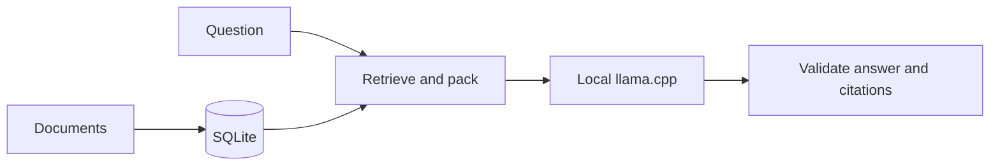

# Local document Q&A and Arm64 inference

The project provides a local document-answering CLI on an Apple M1 Max with 32 GB memory. CPU answers have supported citations and known omissions. KleidiAI passed sampled runtime checks but regressed in the fixed quality comparison, so **CPU remains the application default**. Native measurements favored KleidiAI for prompt processing and CPU for generation. These findings do not imply general Arm64 performance or an application speedup.

## Design and use

Python handles parsing, retrieval, prompt preparation and validation. SQLite stores canonical text, exact source locations, keyword search and optional embeddings. Transactional imports preserve the previous usable index after failure. Pinned llama.cpp binaries run in a separate authenticated local server, started and closed for each answer. [Search](search.md), [embeddings](embeddings.md), [answer setup](answers.md).



After installing the runtime and model:

```sh
uv run --locked --group build arm64-rag index eval/fixtures
uv run --locked --group build arm64-rag ask 'What batch size does the instruction-handling fixture use?'
```

The preset uses Qwen3.5-9B Q8_0, four threads, an 8,192-token context and at most five passages. Its 2,048-token output allowance includes up to 1,024 reasoning tokens; only the final answer appears. Model bytes and template are pinned, although the third-party publisher does not disclose the exact quantization recipe.

Packing counts the complete template and reserves output space. Spare capacity may add the immediately preceding parent introduction. The model returns claims and source labels; the application attaches canonical passages. Invalid labels, malformed output and unfinished generation are rejected. Valid reference locations alone do not prove factual support. [Answer contract](answers.md#sources-and-output).

## Retrieval decision

The corpus contains seven pinned documents and 383 chunks. With five passages and a shared 1,024-token text budget, complete evidence coverage was:

| Questions | Keyword | Dense | Hybrid |
| --- | ---: | ---: | ---: |
| Development | 8/13 | 6/13 | 9/13 |
| Former validation | 14/18 | 13/18 | 16/18 |

Hybrid improved aggregate coverage but lost `val-006`, which keyword search covered. **Keyword retrieval remains the default.** All six runs completed. These are retrieval scores, not answer-quality or controlled latency measurements. The earlier unbudgeted keyword baseline reached 10/13 under a different protocol. [Detailed comparison](results/embedding-comparison/README.md), [original baseline](results/lexical-baseline/README.md).

## Answer quality and backend selection

“Complete” means passing every applicable review criterion. Supported claims must agree with both the supplied sources and their attached citations.

| Backend | Valid / attempted | Supported claims | Passed facts | Complete cases |
| --- | ---: | ---: | ---: | ---: |
| CPU | 40/40 | 78/78 | 66/83 | 30/40 |
| KleidiAI | 38/40 | 74/75 | 63/83 | 28/40 |

CPU completed 11/14 development, 13/18 regression and 6/8 originally fresh cases. Its 17 missing fact units include evidence lost during passage selection and omitted details. KleidiAI had 16 failed and four unassessed facts; execution failures remain in the denominator without becoming invented factual errors. [CPU baseline](results/grounded-answers/README.md).

KleidiAI recovered three facts but lost two and added an unsupported scheduling claim. Those gains do not cancel the regressions. One request failed after roughly 301 seconds, consistent with its 300-second deadline; shutdown then caused the next preparation failure. Neither was retried, and no backend-specific cause is established. [Comparison](results/controlled-cpu/quality.md).

Inputs matched in all 39 cases reaching that check. Five identical answers reused authenticated reviews; 33 valid changed outputs received new source review. Model, prompt, settings and rubric stayed fixed. All 40 questions now serve as regressions. The eight originally fresh questions shared documents with development. Questions and reviews are agent-authored, not human or external validation.

## What the native evidence proves

All 18 final diagnostic probes passed review; an earlier attempt remains excluded. Eight instrumented backend pairs matched inputs. Sampled KleidiAI phases used 249 distinct Q8 weights and recorded positive-shape Neon/DotProd kernel entries. Selected recurrent operations remained on CPU. These samples establish actual dispatch, not an accelerated-work percentage or tracing of every measured operation. [Dispatch evidence](results/controlled-cpu/README.md).

At prefixes 512 and 2,048, each backend restored its own state and reproduced 248,320 finite continuation logits byte-for-byte. CPU and KleidiAI vectors differed. The integration requantizes Q8 weights, so the comparison covers whole backends rather than one isolated kernel. Normal runs rely on source/build/library bindings; diagnostic timings are excluded. [Reproduction and limits](results/controlled-cpu/diagnostics.md).

## Desktop computation results

V4 completed **48/48 runs and 24/24 pairs**, without retries or detected timing interruption within frozen tolerances. Both builds used the same model, four threads and F16 caches; Metal, BLAS, Accelerate and OpenMP were disabled.

Median CPU/KleidiAI duration ratios were **1.501 and 1.465** for 512- and 2,048-token prompts, and **0.690 for both** 128-token generation workloads. Above one favors KleidiAI. Each workload has six pairs; each process mean uses three designated repetitions. All 192 samples remain recorded: 48 initial samples excluded and 144 used. [Ranges, observations and method](results/desktop-cpu/README.md).

All 24 pairs recorded swap activity and remained included under the desktop policy. The strict no-swap study remains incomplete. Docker was stopped and restored; other desktop activity continued. Thermal data was unavailable. Backend order follows round, and three consecutive sessions are not independent replications. No causal, population-confidence or tail-latency claim follows.

Native timings exclude loading, retrieval, tokenization, sampling and prefix/state preparation. Earlier incomplete v2 and sleep-affected v3 results remain separate and unrepaired. V4 disclosed their outcomes and added bounded clock/sleep protection. [Timing scope](benchmarks.md).

## Application results

The CPU application completed **21/21 reviewed observations**: 12 CLI commands and nine fixed-context replays. Median buffered-output times were **116.79, 149.25 and 157.67 seconds** for 618, 1,807 and 2,278 input tokens. Empty retrieval took 15.96 seconds and still started a server, without generation. The exact fixed requests had direct request medians of **99.63, 134.32 and 142.10 seconds**. Each case has three repetitions per stage. [Full tables](results/application-performance/README.md).

Across both stages, median worker peaks were 35.55–38.64 MiB and native-child peaks 15.22–15.77 GiB. These separate process-lifetime peaks are not additive memory use. Twelve observations recorded swap activity; all remained included. Thermal readings were unavailable.

All 18 generated answers matched reviewed CPU outputs: 42/42 supported claims and 24/24 passed fact instances. Three empty controls declined faithfully. These repeated known questions add no fresh accuracy evidence.

Command time includes ledger writing and the ownership handshake, beginning at the parent attempt checkpoint. A pipe receives explicitly flushed, buffered output; **model time to first token is unobserved**. Startup and request timers use direct boundaries. Fresh processes do not imply cold caches, and separate stage medians cannot isolate retrieval cost by subtraction.

V1's excluded compatibility attempt stopped after maintenance sleep, with no answer or fixed replay. V2 added a temporary AC-only assertion without relaxing clock checks. Its two excluded compatibility checks passed; assertion ownership and release were verified after each stage. Docker's recorded configuration and health were restored and verified.

## Reproduction and remaining work

The [public setup workflow](benchmark-setup.md) passed four excluded observations using cached native assets; three recorded swap. Its 600-second candidate remains `pending_review`, not approved for measurement. This is not evidence of fresh downloads, clean builds or cold caches. [Validation](results/public-setup/README.md).

The proposed tracked-tree export passed **933 tests**, with 23 optional skips, in a new offline Python environment. It rebuilt the corpus index, answered one familiar fixture correctly, froze setup/application inputs and exported an unstarted 21-row report. Native assets were cached; this was not a clean native build or a repeated performance/quality study. Exact merged-checkout verification is a later release check. [Workflow evidence](results/application-performance/README.md#reproduction).

Public guides support new data collection and a [new local CPU baseline](answers.md#compare-a-fresh-cpu-baseline). Published hashes cannot reconstruct undistributed historical raw traces. V4 used collector/reporter commit `5c5d59eb52ae6aaeda89297bb7b464ba9e19afc3`. Metal remains an optional, unmeasured GPU comparison.
