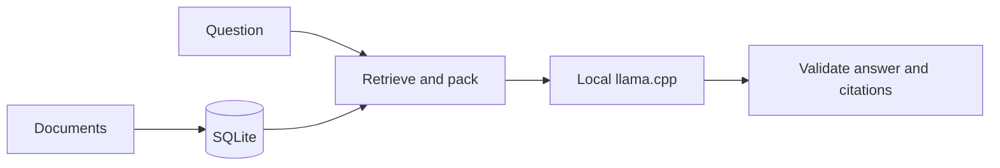

# Local document Q&A and Arm64 inference

The project works as a local document-answering CLI and a focused backend study on an Apple M1 Max with 32 GB memory. KleidiAI processes the tested prompts faster and generates tokens slower. Both backends completed all 40 question checks; 30 answers per backend passed every quality criterion. **CPU remains the application default** because KleidiAI loses two required details and adds an unsupported clause. No KleidiAI application speedup has been measured.

## Design and use

Python handles parsing, retrieval, prompt preparation and validation. SQLite stores canonical text, exact source locations, keyword search and optional embeddings. Transactional imports preserve the previous usable index after failure. Pinned llama.cpp binaries run in a separate authenticated local server, started and closed for each answer. [Search](search.md), [embeddings](embeddings.md), [answer setup](answers.md).



After installing the runtime and model:

```sh
uv run --locked --group build arm64-rag index eval/fixtures
uv run --locked --group build arm64-rag ask 'What batch size does the instruction-handling fixture use?'
```

The preset uses Qwen3.5-9B Q8_0, four threads, an 8,192-token context and at most five passages. Its 2,048-token output allowance includes up to 1,024 reasoning tokens; only the final answer appears. Model bytes and template are pinned, although the third-party publisher does not disclose the exact quantization recipe.

Packing counts the complete template and reserves output space. Spare capacity may add the immediately preceding parent introduction. The model returns claims and source labels; the application attaches canonical passages. Invalid labels, malformed output and unfinished generation are rejected. Valid reference locations alone do not prove factual support. [Answer contract](answers.md#sources-and-output).

## Retrieval decision

The corpus contains seven pinned documents and 383 chunks. With five passages and a shared 1,024-token text budget, complete evidence coverage was:

| Questions | Keyword | Dense | Hybrid |
| --- | ---: | ---: | ---: |
| Development | 8/13 | 6/13 | 9/13 |
| Regression | 14/18 | 13/18 | 16/18 |

Hybrid improved aggregate coverage but lost `val-006`, which keyword search covered. **Keyword retrieval remains the default.** All six runs completed. These are retrieval scores, not answer-quality or controlled latency measurements. An unbudgeted keyword check reached 10/13 under a different protocol. [Detailed comparison](results/embedding-comparison/README.md), [keyword baseline](results/lexical-baseline/README.md).

## Answer quality and backend selection

“Complete” means passing every applicable review criterion. Supported claims must agree with both the supplied sources and their attached citations.

| Backend | Valid / attempted | Supported claims | Passed facts | Complete cases |
| --- | ---: | ---: | ---: | ---: |
| CPU | 40/40 | 78/78 | 66/83 | 30/40 |
| KleidiAI | 40/40 | 80/81 | 67/83 | 30/40 |

All 80 planned cases completed without execution or format failures, with no observed swap activity or detected timing interruption. Both backends used the same questions, retrieved passages, prompts, settings and 300-second request deadline. Inputs matched in all 40 pairs. Quality collection times are excluded from performance comparisons.

CPU passed all applicable criteria in 11/14 development, 13/18 regression and 6/8 validation cases. Its 17 missing fact units include evidence lost during passage selection and omitted details. Supported statements alone do not make an answer complete. [CPU results](results/grounded-answers/README.md).

KleidiAI gained three facts but lost two that CPU supplied: a warning about changing archive hashes and the lack of automatic SME ABI detection. One scheduling clause was unsupported by its supplied text and attached citation. KleidiAI's higher fact total and equal complete-case count do not remove those specific regressions, so it fails the frozen quality gate. This finding is limited to these questions and this rubric. [Paired comparison](results/controlled-cpu/quality.md).

Reviews for 40 CPU and 38 KleidiAI answers were transferred from authenticated, identical outputs from the same backend. Two KleidiAI answers received separate source review. All 40 questions are known regression cases. Questions and reviews are agent-authored, with material ambiguities separately checked by a project contributor. They are not human or external validation and do not establish accuracy on unseen documents. The evidence records retain individual claims, citations, verdicts and review provenance.

## What the native evidence proves

Eighteen reviewed diagnostic probes passed. Eight instrumented backend pairs matched inputs. Sampled KleidiAI phases used 249 distinct Q8 weights and recorded positive-shape Neon/DotProd kernel entries. Selected recurrent operations remained on CPU. These samples establish actual dispatch; they do not measure how much total work was accelerated or trace every measured operation. [Dispatch evidence](results/controlled-cpu/README.md).

At prefixes 512 and 2,048, each backend restored its own state and reproduced 248,320 finite continuation logits byte-for-byte. CPU and KleidiAI vectors differed. Normal runs rely on source/build/library bindings; diagnostic timings are excluded. [Reproduction and limits](results/controlled-cpu/diagnostics.md).

The pinned KleidiAI integration converts Q8 block values to floats, then rounds them again using one scale per weight row. This can change represented weights. The same model file therefore does not guarantee identical arithmetic. Small numerical differences can change token choices and the rest of an answer, but these records do not establish the cause of any particular omission or unsupported claim. This is a comparison of complete backend integrations. [Pinned conversion code](https://github.com/ggml-org/llama.cpp/blob/8ca5a8008b57aa39f2601546c0d07912045080a5/ggml/src/ggml-cpu/kleidiai/kleidiai.cpp#L1530-L1600).

That weight conversion happens during loading, outside native computation timing. Its one-time cost cannot explain the measured generation slowdown. Operator profiling would be needed to establish the bottleneck.

## Desktop computation results

The study **completed 48/48 runs and 24/24 pairs in one uninterrupted
invocation**, with no observed swap activity or detected timing interruption within
frozen tolerances. Both builds used the same model, four threads and F16 caches;
Metal, BLAS, Accelerate and OpenMP were disabled.

Median CPU/KleidiAI duration ratios were **1.503 and 1.464** for 512- and
2,048-token prompts, and **0.699 and 0.704** for the two generation workloads.
KleidiAI used **33.5% and 31.7% less prompt time**, but **43.0% and 42.1% more
generation time**. Each workload has six pairs; each process mean uses three
designated repetitions. All 192 raw samples remain recorded, with 48 initial
samples excluded and 144 used. [Results and method](results/desktop-cpu/README.md).

Prompt processing evaluates many token positions together; generation adds one token at a time. Their different matrix shapes can favor different kernels. Faster prompts and slower generation are therefore technically plausible. All six pairs per workload favor the same backend. Including initial samples or using medians instead of means does not reverse that direction. The exact slowdown remains unexplained.

No competing Docker, VM or project job was observed. macOS, managed security and the editor remained active; thermal data was unavailable. CPU generation times drifted across blocks. Backend order follows round, and the three consecutive blocks are not independent replications. These limits affect precision and attribution; the results do not establish general Arm64 performance, population confidence or tail latency.

Native timings exclude loading, retrieval, tokenization, sampling and prefix/state preparation. Prompt and generation percentages cannot be averaged into an application speedup: the balance depends on input and output lengths, reasoning and startup costs. Only CPU application performance was measured.

## Application results

The CPU application completed **21/21 reviewed observations**: 12 CLI commands and nine fixed-context replays, with three repetitions per case and stage. Median buffered answer times were **113.74, 147.78 and 155.64 seconds** for 618, 1,807 and 2,278 input tokens. Empty retrieval took **14.81 seconds** and still initialized a server without generation. Fixed-context complete-request medians were **98.86, 133.07 and 139.64 seconds**. [Full tables](results/application-performance/README.md).

The answers generated 1,110–1,239 tokens, including reasoning, at native rates of roughly 12 tokens per second. Across all 18 generated observations, request time was 7–19 milliseconds longer than the model’s reported prompt and generation time combined. This supports consistent timing.

Median worker peaks were **36.12–39.08 MiB** and native-child peaks **16.806–16.808 GiB**. No swap activity was observed across 55 recorded host boundaries; thermal readings were unavailable.

All 18 generated answers matched source-reviewed CPU outputs: **42/42 supported claims and 24/24 passed fact instances**. Three empty controls declined faithfully. These known questions and authenticated review transfers add no new accuracy evidence.

Command time includes ledger writing and the ownership handshake, beginning at the parent attempt checkpoint. A pipe receives explicitly flushed, buffered output; **model time to first token is unobserved**. Startup and request timers use direct boundaries. Fresh processes do not imply cold caches, and separate stage medians cannot isolate retrieval cost by subtraction. Worker and native-child memory peaks cover separate process lifetimes and must not be added.

Collectors retain host observations, clock checks and bounded sleep-assertion records. Native timings and these application measurements have different boundaries and answer different questions.

## Reproduction and remaining work

The working tree at `51f14dfce85651cb2b374eeaf424f2d378081089` passed **956 tests and 42 subtests**, with Ruff checks and formatting for 85 files. All 96 retrieval case records reproduced their rankings, scores, source spans and coverage. Eighteen embedding reference checks passed, and 29 cached model/runtime/configuration assets matched their frozen hashes. These checks used the existing environment and cached assets; they do not establish a fresh installation or clean native build. [Verification scope](results/application-performance/verification.json).

Four setup-only observations through the unchanged public API completed with no observed swap. The exported 600-second candidate remains `pending_review`; a separate review approved that calibration for the desktop study. These setup observations are excluded from performance summaries and make no separate command-line execution claim. [Validation](results/public-setup/README.md).

Collection reviews and publication checks have separate evidence. This preparation record makes no merged-checkout verification claim.

Public guides support new data collection and a [new local CPU baseline](answers.md#compare-a-fresh-cpu-baseline). Published hashes cannot reconstruct undistributed raw traces. The desktop study used collector/reporter commit `15dc33dc736c5aaa92fa8afd3e8f61d07dd65241`. Exact bottleneck profiling, human answer review and an optional Metal comparison would extend these findings.
