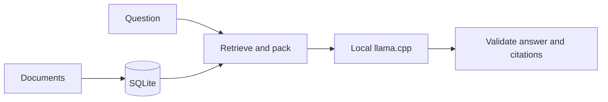

# Local document Q&A and Arm64 inference

The project works as a local document-answering CLI and a focused backend study on an Apple M1 Max with 32 GB memory. KleidiAI processes the tested prompts faster and generates tokens slower. Both backends answered all 40 fixed questions and each produced 30 complete answers, 28 of them on the same questions. **CPU is the application default.** KleidiAI does not pass the project's strict no-regression quality rule, and the native results suggest it would be slower for this generation-heavy application. KleidiAI application performance was not measured.

## Design and use

Python handles parsing, retrieval, prompt preparation and validation. SQLite stores canonical text, exact source locations, keyword search and optional embeddings. Transactional imports preserve the previous usable index after failure. Pinned llama.cpp binaries run in a separate authenticated local server, started and closed for each answer. [Search](search.md), [embeddings](embeddings.md), [answer setup](answers.md).



After installing the runtime and model:

```sh
uv run --locked --group build arm64-rag index eval/fixtures
uv run --locked --group build arm64-rag ask 'What batch size does the instruction-handling fixture use?'
```

The preset uses Qwen3.5-9B Q8_0, four threads, an 8,192-token context and at most five passages. Its 2,048-token output allowance includes up to 1,024 reasoning tokens; only the final answer appears. Model bytes and template are pinned, although the third-party publisher does not disclose the exact quantization recipe.

Packing counts the complete template and reserves output space. Spare capacity may add the immediately preceding parent introduction. The model returns claims and source labels; the application attaches canonical passages. Invalid labels, malformed output and unfinished generation are rejected. Valid reference locations alone do not prove factual support. [Answer contract](answers.md#sources-and-output).

## Retrieval decision

The corpus contains seven pinned documents and 383 chunks. With five passages and a shared 1,024-token text budget, complete evidence coverage was:

| Questions | Keyword | Dense | Hybrid |
| --- | ---: | ---: | ---: |
| Development | 8/13 | 6/13 | 9/13 |
| Retrieval validation | 14/18 | 13/18 | 16/18 |

Hybrid improved aggregate coverage but lost `val-006`, which keyword search covered, so **keyword retrieval is the default** under the no-regression rule. All six runs completed. These are retrieval scores, not answer-quality or controlled latency measurements. An unbudgeted keyword check reached 10/13 under a different protocol. The 18 retrieval-validation questions also form the answer `regression` split; the answer `validation` split is a separate set of eight questions. [Detailed comparison](results/embedding-comparison/README.md), [keyword baseline](results/lexical-baseline/README.md).

## Answer quality and backend selection

“Complete” means passing every applicable review criterion. Supported claims must agree with both the supplied sources and their attached citations.

| Backend | Valid / attempted | Supported claims | Passed facts | Complete cases |
| --- | ---: | ---: | ---: | ---: |
| CPU | 40/40 | 78/78 | 66/83 | 30/40 |
| KleidiAI | 40/40 | 80/81 | 67/83 | 30/40 |

All 80 planned cases completed without execution or format failures, with no observed swap activity or detected timing interruption. Both backends used the same questions, retrieved passages, prompts, settings and 300-second request deadline. Inputs matched in all 40 pairs. Quality collection times are excluded from performance comparisons.

CPU passed all applicable criteria in 11/14 development, 13/18 regression and 6/8 validation cases. Its 17 missing fact units include evidence lost during passage selection and omitted details. Supported statements alone do not make an answer complete. [CPU results](results/grounded-answers/README.md).

Each backend had 30 complete cases, 28 of them the same. KleidiAI supplied three facts CPU missed (`dev-010`, `val-004`, `fresh-005`). It missed two facts CPU supplied: a warning about changing archive hashes (`val-009`) and the lack of automatic SME ABI detection (`val-011`). One KleidiAI scheduling clause in `dev-010` was unsupported by its supplied text and attached citation.

The project's frozen quality rule rejects a backend that loses any fact CPU supplied or adds an unsupported claim, whatever else it gains, so KleidiAI does not pass. The rule is deliberately strict and one-sided: applied the other way round, it would also reject CPU. Each question was answered once with seeded sampling at temperature 0.6, and different arithmetic can change which tokens are sampled. Single answers therefore cannot separate a backend effect from sampling variation, and these results do not show that either backend is more accurate. This finding is limited to these questions and this rubric. [Paired comparison](results/controlled-cpu/quality.md).

Reviews for 40 CPU and 38 KleidiAI answers were transferred from authenticated, identical outputs from the same backend. Two KleidiAI answers received separate source review. All 40 questions are known regression cases. Questions and reviews are agent-authored, with material ambiguities separately checked by a project contributor. They are not human or external validation and do not establish accuracy on unseen documents. The evidence records retain individual claims, citations, verdicts and review provenance.

## What the native evidence proves

Eighteen reviewed diagnostic probes passed. Eight instrumented backend pairs matched inputs. In every traced phase, KleidiAI handled all 249 Q8_0 matrix weights in the model, with positive-shape Neon/DotProd kernel entries. The model's only other Q8_0 tensor is the token-embedding table, which is read by lookup rather than matrix multiplication. Selected recurrent operations remained on CPU. These samples establish actual dispatch. They trace only the first batch of each phase, so they do not measure how much total work was accelerated. [Dispatch evidence](results/controlled-cpu/README.md).

At prefixes 512 and 2,048, each backend restored its own state and reproduced 248,320 finite continuation logits byte-for-byte. CPU and KleidiAI vectors differed. Normal runs rely on source/build/library bindings; diagnostic timings are excluded. [Reproduction and limits](results/controlled-cpu/diagnostics.md).

The pinned KleidiAI integration converts each Q8_0 weight row to 8-bit values with a single scale, set by the row's largest value. Q8_0 stores one scale per 32 weights, and the standard CPU backend keeps those scales. Blocks of smaller values therefore lose precision, so KleidiAI computes with a coarser version of the same model. It also quantizes activations with one scale per row, where the standard path uses one scale per 32 values. These differences could contribute to answer differences, but these records do not establish the cause of any omission or unsupported claim. The comparison covers complete backend integrations, not kernels alone. [Pinned conversion code](https://github.com/ggml-org/llama.cpp/blob/8ca5a8008b57aa39f2601546c0d07912045080a5/ggml/src/ggml-cpu/kleidiai/kleidiai.cpp#L1530-L1600).

The weight conversion runs once while loading, outside the native computation timing, so its one-time cost cannot explain the slower generation; the converted format is used inside the timed work. The conversion does lengthen startup; see the [application estimate](#kleidiai-estimate-for-this-application). Operator profiling would be needed to find the generation bottleneck.

## Desktop computation results

The study **completed 48/48 runs and 24/24 pairs in one uninterrupted
invocation**, with no observed swap activity or detected timing interruption within
frozen tolerances. Both builds used the same model, four threads and F16 caches;
Metal, BLAS, Accelerate and OpenMP were disabled.

Median CPU/KleidiAI duration ratios were **1.503 and 1.464** for 512- and
2,048-token prompts, and **0.699 and 0.704** for the two generation workloads.
KleidiAI used **33.5% and 31.7% less prompt time**, but **43.0% and 42.1% more
generation time**. CPU processed about 59–62 prompt tokens per second and
generated about 12; KleidiAI processed about 86–92 and generated about 8.4–8.6.
Each workload has six pairs; each process mean uses three designated
repetitions. All 192 raw samples remain recorded, with 48 initial samples
excluded and 144 used. [Results and method](results/desktop-cpu/README.md).

Prompt processing evaluates many token positions together; generation adds one token at a time. Their different matrix shapes can favor different kernels, so faster prompts and slower generation are plausible. All six pairs per workload favor the same backend. Including initial samples or using medians instead of means does not reverse that direction. The cause of the slower generation is unknown; it may lie in the kernels or in how llama.cpp uses them.

No competing Docker, VM or project job was observed. macOS, managed security and the editor remained active, and thermal data was unavailable.

Recorded load was high before and at the start of measurement: the 15-minute load average was 65.7 before setup and 22.7 when the first block began, and stayed below 8 in the second and third blocks. Block median ratios differed between blocks by at most 0.042. CPU generation after the 512-token prefix varied most, with block medians of 10.98, 10.42 and 10.25 seconds.

KleidiAI ran first in round 1 and CPU first in round 2 of each block. Pair ratios were similar in either order, but because order is tied to round, order and round effects cannot be separated. The three consecutive blocks are not independent replications. These limits affect precision and attribution; the results do not establish general Arm64 performance, population confidence or tail latency.

In two setup runs per backend, KleidiAI's peak memory was 17.3–17.4 GiB, against 15.2–16.7 GiB for CPU. The measured runs did not record memory, so this is not a controlled memory comparison.

Native timings exclude loading, retrieval, tokenization, sampling and prefix/state preparation. Prompt and generation percentages cannot be averaged into one speedup: the balance depends on input and output lengths, reasoning and startup.

## Application results

The CPU application completed **21/21 reviewed observations**: 12 CLI commands and nine fixed-context replays, with three repetitions per case and stage. Median times until the buffered answer appeared were **113.74, 147.78 and 155.64 seconds** for 618, 1,807 and 2,278 input tokens. A question with no matching passages took **14.81 seconds**; it still started a server but generated nothing. Fixed-context complete-request medians were **98.86, 133.07 and 139.64 seconds**. [Full tables](results/application-performance/README.md).

The answers generated 1,110–1,239 tokens, including reasoning, at about 12 tokens per second. Across all 18 generated observations, request time was 7–19 milliseconds longer than the model’s reported prompt and generation time combined, which supports consistent timing.

Median worker peaks were **36.12–39.08 MiB** and model-server peaks **16.806–16.808 GiB**. No swap activity was observed across 55 recorded host boundaries; thermal readings were unavailable.

All 18 generated answers matched source-reviewed CPU outputs: **42/42 supported claims and 24/24 passed fact instances**. Three empty controls declined faithfully. These known questions and authenticated review transfers add no new accuracy evidence.

Answer times start before the harness writes its records and launches the command, so they include small harness overheads. The command prints its whole answer at once, so **model time to first token was not observed**. Server startup and request times are measured directly. Fresh processes do not mean cold caches, and stage medians cannot be subtracted to isolate retrieval cost. Worker and model-server memory peaks cover separate processes and must not be added.

Collectors retain host observations, clock checks and sleep-prevention records. Native timings and these application measurements have different boundaries and answer different questions.

### KleidiAI estimate for this application

KleidiAI application performance was not measured. This estimate applies the native results to the CPU application timings and is untested.

- **Generation dominates.** Median generation time, including reasoning, was 89–102 seconds of each 99–141-second CPU request; median prompt processing took 10–39 seconds. Generation is the workload where KleidiAI is slower.
- **Startup recurs.** The application starts a model server for every question. In the desktop study, subtracting the timed samples and llama-bench's untimed warmup or prefix run from each process's wall time leaves about 26 seconds per KleidiAI process, against about 10 for CPU. This suggests KleidiAI takes about 16 seconds longer to load, consistent with its weight conversion. The CPU figure is close to the application's measured 9.8 seconds from server launch to readiness.
- **Estimated effect.** Dividing the CPU prompt and generation times by the native ratios gives about 133–171 seconds per KleidiAI request. With the extra startup, complete answers would take about 163–202 seconds, against 114–156 seconds on CPU: about 30–44% longer.
- **Less deadline margin.** At the native rates, a 2,278-token prompt with the full 2,048-token output allowance would take about 270 seconds on KleidiAI, close to the 300-second request limit, against about 210 seconds on CPU. Both figures are probably slightly low, because generation slows as context grows beyond the measured 2,048-token prefix.

The estimate applies the 2,048-token-prefix generation ratio to answers that run at longer contexts and assumes equal answer lengths on both backends. It also assumes the llama-bench startup difference carries over to the application's server, which uses the same batch, cache and attention settings.

## Reproduction and remaining work

The working tree at `51f14dfce85651cb2b374eeaf424f2d378081089` passed **956 tests and 42 subtests**, with Ruff checks and formatting for 85 files. All 96 retrieval case records reproduced their rankings, scores, source spans and coverage. Eighteen embedding reference checks passed, and 29 cached model/runtime/configuration assets matched their frozen hashes. These checks used the existing environment and cached assets; they do not establish a fresh installation or clean native build. [Verification scope](results/application-performance/verification.json).

Four setup-only observations through the unchanged public API completed with no observed swap. The exported 600-second candidate has status `pending_review`; a separate review approved that calibration for the desktop study. These setup observations are excluded from performance summaries and make no separate command-line execution claim. [Validation](results/public-setup/README.md).

Collection reviews and publication checks have separate evidence. This preparation record makes no merged-checkout verification claim.

Public guides support new data collection and a [new local CPU baseline](answers.md#compare-a-fresh-cpu-baseline). Published hashes cannot reconstruct undistributed raw traces. The desktop study used collector/reporter commit `15dc33dc736c5aaa92fa8afd3e8f61d07dd65241`. Answers with several different seeds per question on each backend would show whether answer differences exceed sampling variation. A measured KleidiAI application run would test the estimate above. Operator profiling, human answer review and an optional Metal comparison would extend these findings.
